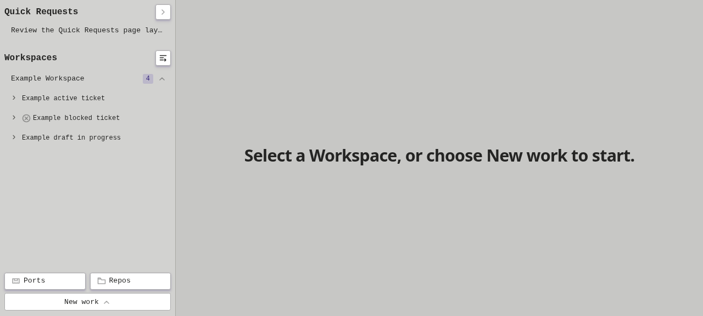
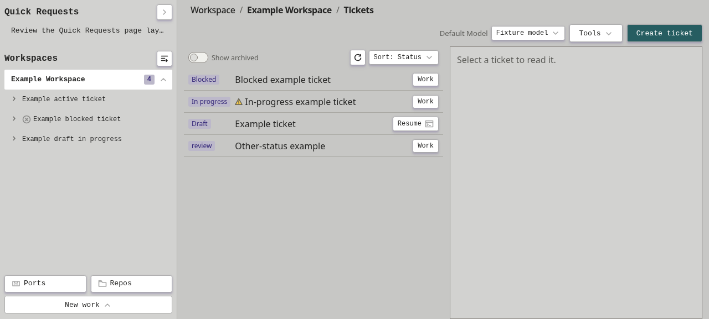
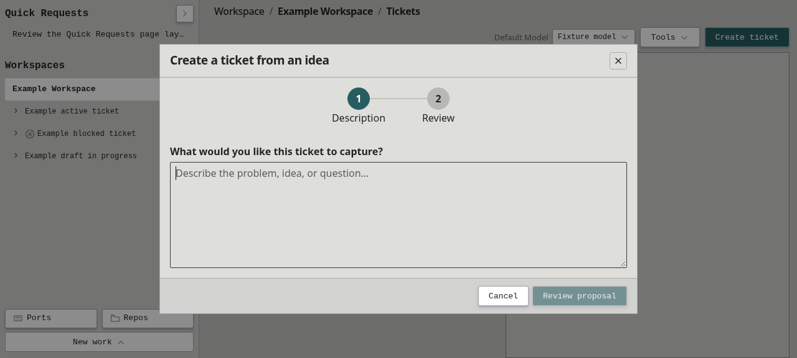
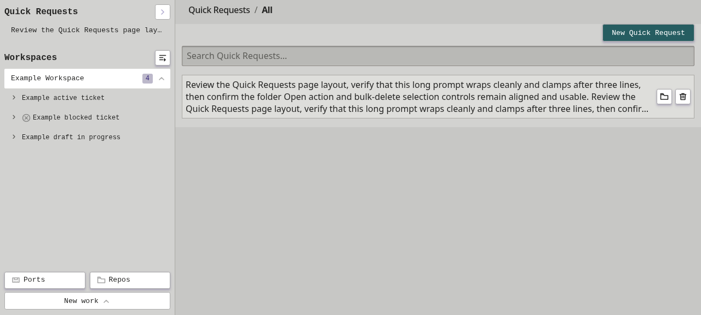
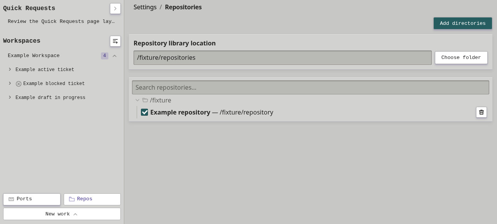
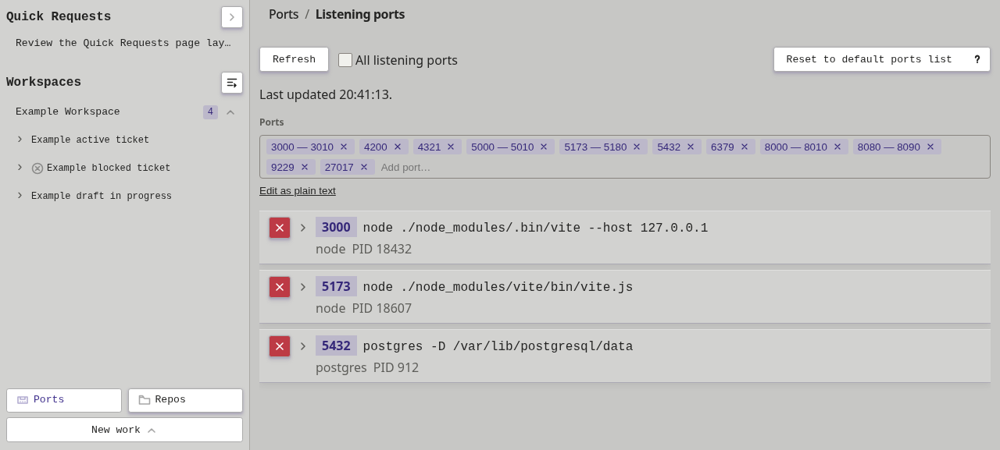

# Frontend feature and UX inventory

This is a source-grounded guide to the current frontend: what each visible area
does, how users move through it, and where the presentation is composed. It
describes the ticket-first UI currently in `app/src`; some older screen notes
describe retired Workspace → Task flows.

Screenshots below come from the browser-only mock and its deterministic fixture
data. They show representative layout and controls, not live repository,
OpenCode, Tauri, terminal, or operating-system behavior. Reloading the mock resets
its state. The mock cannot open native folders or run tools.

## At a glance

The application is one fixed-height shell with two columns: a persistent left
navigation rail and a main content area. Selecting a navigation destination
replaces the right-hand content; it does not create a permanent second content
pane. Some destinations have their own side-by-side panes (ticket list/reader,
Docs file tree/content, and Change Review file tree/diff).

```text
┌ Persistent left rail ───────────┬ Main content for current selection ──────┐
│ Quick Requests                  │ Ticket browser, reader, terminal, Docs,   │
│ Workspaces and ticket links     │ Change Review, Repositories, Ports, etc. │
│                                 │                                           │
│ Ports       Repositories        │                                           │
│ New work                        │                                           │
└─────────────────────────────────┴───────────────────────────────────────────┘
```



## 1. Application shell and navigation

### Shell geometry and scrolling

- `body`, `.shell`, and `.workspace-layout` fill the viewport height (`100dvh`);
  the document itself does not scroll. The body has a 360px minimum width.
- The left rail is a CSS Grid column (`max-content`) with a subtle right divider.
  It has a 260px minimum and 320px maximum width at normal sizes. At viewport
  widths up to 680px, it changes to a 150px minimum and a 34vw maximum. It is not
  a drag-resizable splitter. At widths below the app's 360px minimum, horizontal
  layout fit is not promised.
- The right pane takes the remaining width and has `min-width: 0` so its content
  can shrink without pushing the shell wider. Main content is destination-owned;
  navigation remains visible during Quick Request terminal use.
- The rail's Workspace/ticket list has its own vertical scroll. Recent Quick
  Requests have a separate scroll region capped at 10rem. Ports, Repositories,
  and New work stay anchored at the bottom instead of scrolling away.
- The ticket reader/list, Docs tree/content, Change Review tree/diff, and Ports
  process list are further independent scroll areas. This keeps the shell and
  high-value controls in place while long content moves.

### Quick Requests navigation group

- A static **Quick Requests** heading sits first in the rail. Its adjacent
  icon-only chevron opens the full retained Quick Requests list; the heading
  itself is not a separate destination.
- The list below contains requests created in the last 24 hours. A row shows
  truncated prompt text and selects/opens that Quick Request. There is no row
  delete control here. The selected request is highlighted.
- Older requests remain accessible from the full list. Selecting a Workspace or
  deleting the selected request clears the selected-request highlight.

### Workspace and ticket navigation

- The sidebar tabs are **Recent** and **Workspaces**. Recent is the flat,
  modification-sorted session-backed ticket list. Its **Create ticket** button
  sits above the list and opens the standard ticket proposal/review modal with a
  required Workspace picker. Workspaces retains the grouped Workspace layout.
- The Workspace picker puts up to 20 active Workspaces with completed tickets
  first, ranked by the newest completed ticket's file-modification time. The
  remaining Workspaces follow alphabetically, case-insensitively. Both sections
  can be filtered; opening the picker focuses its filter. Arrow Up/Down move
  through options, Home/End move to the first/last option, Enter selects, and
  Escape closes the picker without closing the modal.
- Workspace names in the grouped sidebar are sorted alphabetically without
  regard to capitalization.
- **Workspaces** has an icon-only view toggle. Its accessible label describes
  the action that will happen next: **Show flat ticket list** or **Group tickets
  by Workspace**. Grouped mode is the initial mode.
- Only active regular Workspaces are shown. Each Workspace row is a destination
  that opens its ticket browser. A count beside its name counts all `draft`,
  `in_progress`, and `blocked` tickets, including drafts that are intentionally
  omitted from the ticket-link rows.
- In grouped mode, each Workspace starts expanded. The Workspace name and its
  adjacent chevron are separate controls: the name selects the Workspace; the
  chevron only expands/collapses its visible ticket links. A disclosure control
  appears only when the Workspace has an eligible ticket to show.
- Eligible navigation tickets are `in_progress`, `blocked`, and `draft` tickets
  that already have an OpenCode work session. A new draft without a work session
  still appears in the Workspace ticket browser and count, but not as a rail link.
- Grouping is driven by each ticket's `projectLabel`. A label that matches a
  Workspace name is shown under that Workspace. A label shared by multiple
  Workspaces can appear as a shared label group; other tickets remain under
  their owning Workspace. Fixture tickets default their label to the Workspace
  name. The label is ticket metadata, not a property inferred from the current
  screen.
- A ticket navigation row directly invokes that ticket's **Work** action; it is
  not merely a selection shortcut. Blocked tickets have a blocked marker. Session
  attention indicators can separately signal waiting, idle/ready, or a problem.
- Right-clicking a ticket row opens **Change label…**. The modal shows the
  current label, searches known labels, offers a create-from-query option, and
  applies the selected label to that ticket. Applying refreshes navigation so
  grouping updates. The context menu dismisses on outside pointer interaction;
  the label dialog uses its explicit Cancel/Apply controls and shared modal
  keyboard behavior.
- Flat mode lists Workspace destinations first, then eligible tickets sorted by
  newest file modification. Flat ticket rows omit the Workspace name; selecting
  one still routes to the ticket's owning Workspace and invokes Work.
- Empty navigation explains that **New** below creates a Workspace. Legacy Task
  records are not displayed as regular navigation destinations.

### Pinned destinations and New work

- **Ports** and **Repositories** are full-width destinations sharing the bottom
  rail row, immediately above **New work**. They replace the main content, not
  the navigation.
- **New work** opens upward as an overlay so it does not move the rail. Its menu
  offers **Workspace** and **Quick Request**; it does not offer Task creation.
  Choosing an item opens the creation modal over the current destination, which
  remains intact if the user cancels.
- The Workspace-creation Repository picker is filterable. Opening it focuses the
  filter and uses the same arrow, Home/End, Enter, and Escape behavior as the
  sidebar Workspace picker.

## 2. Workspace ticket browser

Selecting a Workspace opens its ticket browser first. It does not automatically
start an OpenCode session. The top masthead identifies `Workspace / <name> /
Tickets`; the header below contains the app-wide Default Model selector, a
Workspace-level Tools menu, and the primary **Create ticket** action.



### Ticket list and reader

- The body is a two-column layout: a compact ticket list on the left and a
  selected-ticket reader on the right. Each pane scrolls independently. The
  list's width is bounded so it cannot consume the entire reader area.
- Rows show a status badge, session-attention indicator when relevant, title,
  and a row action. Clicking the title selects it for reading only; it does not
  start a session or change ticket status. **Work** or **Resume** is a separate
  row action. It selects the ticket and opens/resumes its work session.
- Active tickets sort by **Status** (default: blocked, in progress, draft, then
  other statuses; newest modification first within status), **Recently modified**,
  or **Title**. Archived tickets have independent sort state and offer **Status**,
  **Archive time** (default), or **Title**.
- **Show archived** switches list scope and clears current selection. The app
  displays archived tickets but does not archive them or change their Markdown
  status. Archived rows show an archive date rather than Work.
- **Refresh tickets** reloads the list. Loading and command errors are surfaced
  in the page; ticket-file change events also refresh navigation/list data.
- With no selection, the reader says **Select a ticket to read it**. A selection
  renders the complete Markdown body through the ticket Markdown renderer,
  followed by formatted frontmatter metadata. App-maintained `opencode-status`
  is intentionally excluded from that metadata display.

### Default Model and ticket creation

- **Default Model** uses the enabled OpenCode model catalog and saves the chosen
  app-wide default. If the configured model is unavailable, the UI requires an
  explicit available choice rather than silently substituting another model.
  Ticket creation/Work actions that need a model are unavailable until one is
  selected.
- **Create ticket** opens a two-step dialog titled **Create a ticket**. Step 1 captures the idea and asks
  OpenCode to propose a ticket. Step 2 shows editable title and Markdown body;
  the app-managed `draft` status is read-only. **Back** returns to the idea.
- The optional **Start ticket** checkbox is off by default. If selected, ticket
  creation also starts the bounded ticket investigation described by the
  workflow; it does not open the terminal/workbench. The created draft is
  selected. A proposal failure stays in the dialog; a create failure preserves
  edits. An investigation setup failure is reported without inviting a second
  create that could duplicate the ticket.



### Ticket workbench, sessions, and tools

- **Work/Resume** opens or restores the ticket's associated OpenCode session.
  The main ticket browser is replaced by a ticket workbench. The masthead shows
  `Workspace / <name> / Tickets / <ticket title>`; selecting the Workspace name
  returns to the ticket browser without closing the terminal.
- The compact toolbar has **New session**, a shared tab strip, and **Tools**.
  Ticket work has one OpenCode session tab, plus Docs and (when a repository is
  available) Change Review. Tab switching only changes the presented surface;
  it does not stop other terminal sessions. Close acts on the exact tab; Restart
  is separate and applies to the selected exited terminal.
- Starting a new ticket session attaches its replacement before switching the
  ticket's session binding and closing the old terminal. Closing a ticket tab
  closes its terminal and clears the ticket binding, but does not delete the
  OpenCode conversation.
- On the ticket browser, **Tools** is available without selecting a ticket and
  offers external terminal, IntelliJ, and folder handoffs to the Workspace's
  verified repository checkout. In the ticket workbench, Tools also exposes the
  app terminal and detected repository project commands; these use the ticket's
  verified worktree if recorded, otherwise the Workspace checkout. Project
  commands show their package.json/Makefile directory. These actions are menus,
  not persistent panels.

## 3. Workspace navigation's Docs and Change Review destinations

Both are selected from the ticket workbench toolbar, remain within the selected
ticket context, and leave its terminal tab open. Their side-by-side navigator is
resizable; Docs and Change Review share the remembered navigator width.

### Docs reader

- **Docs** lists discovered Markdown and text files, grouped by source
  (Workspace/repository), in a tree beside the selected content. Folders can be
  collapsed; selecting a file changes the reader without closing the tree.
- Paths are source-relative. Markdown is rendered as sanitized content; text is
  shown as plain text. Long content wraps, code/table formatting is preserved as
  appropriate, and loading/errors/empty states are shown in the content area.
- Docs is available only in ticket workbench context. Its tab is disabled after
  discovery confirms no matching files. It is a reader, not a general file
  browser or editor.

### Change Review

- **Change Review** is available when a verified repository is associated with
  the selected Workspace/ticket. A changed-file tree sits beside the selected
  diff. Files are grouped by repository and by branch changes versus local
  changes; each file shows its Git status.
- The header identifies repository, file count, comparison ref, and merge base
  where available. Search filters paths. The file tree navigator is resizable
  and shared with Docs.
- The diff can be switched between unified and split presentation; this
  preference is remembered. Selecting a file updates the diff. Loading, no
  changes, comparison errors, and unavailable text diffs have explicit states.
- This is an app content tab, not a terminal. Changing tabs never consumes,
  closes, or replaces the ticket's OpenCode terminal.

## 4. Quick Requests

### Full list

The chevron by the rail's Quick Requests heading opens **Quick Requests / All**
in the right pane. This is a destination, not a modal or permanent split view.



- **New Quick Request** opens the same creation flow as the New work menu.
- Search matches the original prompt case-insensitively as a literal substring;
  leading/trailing query whitespace is ignored. Search is local to this list and
  does not change saved data.
- Each row has an explicit **Open** action; prompt text itself is not a link.
  Delete enters a bulk-selection mode with that item preselected. Checkboxes then
  appear on every row and a danger action deletes all selected items after one
  confirmation. **Cancel** exits without deleting.
- The original prompt is wrapped and clamped to three lines. The complete list
  includes older retained items; the navigation rail remains available to leave
  the destination.

### Dedicated Quick Request terminal

Opening a Quick Request shows its `Quick Request / <name>` masthead and an
interactive terminal filling the remaining right-hand work area. The rail stays
visible. This page deliberately has no Workspace tabs, ticket controls, Tools,
or app-rendered conversation transcript. Navigating elsewhere hides but does not
stop its terminal; reopening restores the same tracked session. Deletion removes
the app-side request/session association and closes its attached terminal, not
OpenCode's conversation history.

## 5. New work modal

The shared New work dropdown has two flows; the active content is a modal, not a
replacement screen. The modal has a fixed header/footer and a body that scrolls
when needed. Cancel/Escape leave the current destination as it was; clicking
outside does not dismiss it. Focus is moved into the current step and returned to
the menu trigger on close.

### Create Workspace (direct form)

- The **Repository** selector offers a registered repository or **Create an
  empty workspace**. Registered repository choice suggests an editable title
  from its name and links directly to that repository; it does not clone it.
- Empty-workspace choice asks for title and required short description. Rust
  creates/registers a local Git repository under the configured library root,
  username, and Workspace slug, then associates it. There is no separate
  Workspace home directory.
- **Create Workspace** stays disabled until the required choices/fields are
  present. Validation/creation errors remain in the open form. Success selects
  the Workspace and opens its ticket browser; OpenCode starts later, via a
  ticket's Work action.

### Create Quick Request

- Capture asks for an **Original prompt** and a **Working directory**, with a
  folder chooser. The directory can be explicitly changed. The proposal resolves
  the safe working directory; the user can edit/choose/reset the resolved path.
- Review identifies the confirmed working directory, offers **Original** and
  **Suggested** prompt tabs, and a model selector. Suggested prompt is editable.
  This is a noteworthy implementation detail: the UI permits choosing/editing a
  suggested starting prompt, although the current approved workflow prose says
  the original prompt is sent unchanged. Treat the exact selected-prompt
  behavior as an implementation/spec clarification point, not as settled UX.
- Confirmation creates the tracked Quick Request and session, attaches the
  terminal, and reveals the destination after startup acceptance. If startup or
  prompt delivery fails after durable creation, the modal offers **Retry
  startup**, reusing the saved request/session rather than creating another.

## 6. Repositories (discovery and management; no separate Import page)

Repositories is the app's import-like workflow: users explicitly select
directories and the app discovers Git repositories beneath them. It does not
silently import or attach every repository to a Workspace.



- The masthead is **Settings / Repositories**. The page offers **Add
  directories**, a **Repository library location** field with folder picker, and
  a searchable directory tree of discovered repositories.
- Adding directories opens a native multi-folder picker in the real app; selected
  roots are scanned for Git repositories. Saved scan roots are rescanned at
  startup. The repository library location is where managed checkouts are kept;
  it is distinct from existing source checkout locations.
- Search matches repository name or full path and retains the directory
  ancestors needed to show matches. Each repository has an enable checkbox and
  visible path. Enabled repositories can be selected for Workspace creation or
  Quick Request directory resolution; enabling does not attach one to a
  Workspace.
- A repository delete icon enters multi-select mode; confirm **Delete
  selected** to soft-delete catalog entries. This does not delete repository
  files or existing Workspace associations. The same canonical path remains
  suppressed in later scans.
- Repository discovery is an explicit directory selection, not an upload,
  archive extraction, URL clone, or automatic Workspace import. OpenCode's
  configured Projects root and the repository library are excluded from broad
  scanning.

## 7. Ports

Ports inspects accessible TCP listeners and groups results by process.



- Opening the destination refreshes accessible listeners. **Refresh** repeats
  the inspection; the page shows the last successful refresh time.
- The default persisted port/range filter can be edited as removable tags or
  plain text. Users can restore defaults or enable **All listening ports**.
  Invalid edits do not replace the saved filter. An empty state distinguishes no
  accessible listeners from no matches for the current filter.
- A collapsed process row shows ports, command, process name, and PID. Expanding
  shows owner, bind addresses, working directory, and start information; absent
  or permission-hidden values are labeled unavailable, not guessed. A wildcard
  bind is called out as listening on all interfaces, with a reachability caveat.
- The danger stop icon targets one process, is disabled if identity cannot be
  verified, and has no confirmation dialog. The app requests graceful stop then
  may force-stop after five seconds. Errors remain visible; command lines are
  displayed locally only.

## 8. Supporting UI and feedback

- **No selection** is a small prompt to choose a Workspace or start new work;
  it is not a dashboard or startup wizard.
- **App notice / command errors** surface errors without replacing the current
  destination. Forms and lists also keep local validation, loading, and status
  feedback close to the action that caused them.
- **Application status** is visually hidden from the normal shell and exposed
  for assistive technology. Frontend command diagnostics are bounded
  in-memory metadata, not an on-screen feature panel.
- Shared controls use the product-neutral `@ui-lib` package: buttons, inputs,
  selects, switches, checkboxes, icon buttons/icons, modals, action menus,
  tooltips, tabs, status, and notice/presentation primitives. Product behavior
  and composition stay in `app/src`.

## 9. Frontend implementation map and import boundaries

`app/src/main.js` is the composition root. It creates one application lifetime,
connects destination controllers and shared selection, and mounts one Solid tree
through `ApplicationRoot`; features do not mount separate roots.

| Area                   | Main implementation                                           | Responsibility                                                                                   |
| ---------------------- | ------------------------------------------------------------- | ------------------------------------------------------------------------------------------------ |
| Shell/lifetime         | `application/`, `main.js`                                     | Persistent shell, right content selection, shared notices/status, lifetime and teardown.         |
| New work               | `features/new-work/`                                          | Menu, modal flow, proposal/review state, Workspace/Quick Request creation.                       |
| Quick Requests         | `views/quick-requests/`                                       | Recent list, all-list search/deletion, selection and reopen flow.                                |
| Workspace/tickets      | `views/workspace/navigation/`, `tickets/`                     | Grouped/flat rail, label editing, ticket list/reader/create/Work.                                |
| Sessions/tools         | `views/workspace/sessions/`, `repository-tools/`, `terminal/` | Session/tab coordination, interactive xterm presentation, tool menu.                             |
| Docs/Change Review     | `views/workspace/docs/`, `change-review/`                     | Ticket-scoped file reader and Git diff presentation.                                             |
| Repositories/Ports     | `views/directories/`, `views/ports/`                          | Repository catalog UI and listening process/filter UI.                                           |
| Shared app-specific UI | `components/`                                                 | Navigation items, page layouts, ticket label/session controls, file trees.                       |
| Generic presentation   | `packages/ui-lib/`                                            | Product-neutral visual controls imported through `@ui-lib`.                                      |
| Tauri boundary         | `services/commandContract.js` and `shell.js`                  | Typed command contract/adapters; production view code does not call raw Tauri `invoke` directly. |

Workspace composition is explicit: `ApplicationRoot` renders the navigation
rail and a single selected-work region; `RightContentShell` selects which
destination surfaces are visible; `WorkspaceShell` supplies the ticket-workbench
masthead and tabs; feature controllers own request/state transitions and pass
callbacks into presentation components. Rust owns durable records, validation,
filesystem/Git operations, and processes. The frontend owns presentation state,
input, sorting, filtering, visible selection, and command wiring—not product
authority.

## Source/spec notes

- Current UI descriptions above follow `ApplicationRoot.jsx`, `RightContentShell.jsx`,
  `WorkspaceShell.jsx`, the view components/controllers, and their CSS Modules.
- `docs/ux/index.md` and `docs/ux/screen-workspace.md` predate parts of the
  ticket-first implementation. In particular, older mentions of Workspace
  sessions as the default Workspace screen, Tasks, and former multi-repository
  behavior should not override the approved ticket-first workflow in
  `docs/workspace-ticket-workflow-proposal.md`.
- Current Quick Request review UI visibly offers Original/Suggested prompt
  selection and a model selector, while current workflow prose says the original
  prompt is sent unchanged. That discrepancy merits an explicit product decision
  before changing behavior or treating either description as definitive.
- Screenshots are browser/mock evidence only. They do not prove native Tauri
  rendering, native folder pickers, actual OpenCode responses, process control,
  terminal PTY behavior, or Wayland acceptance.
